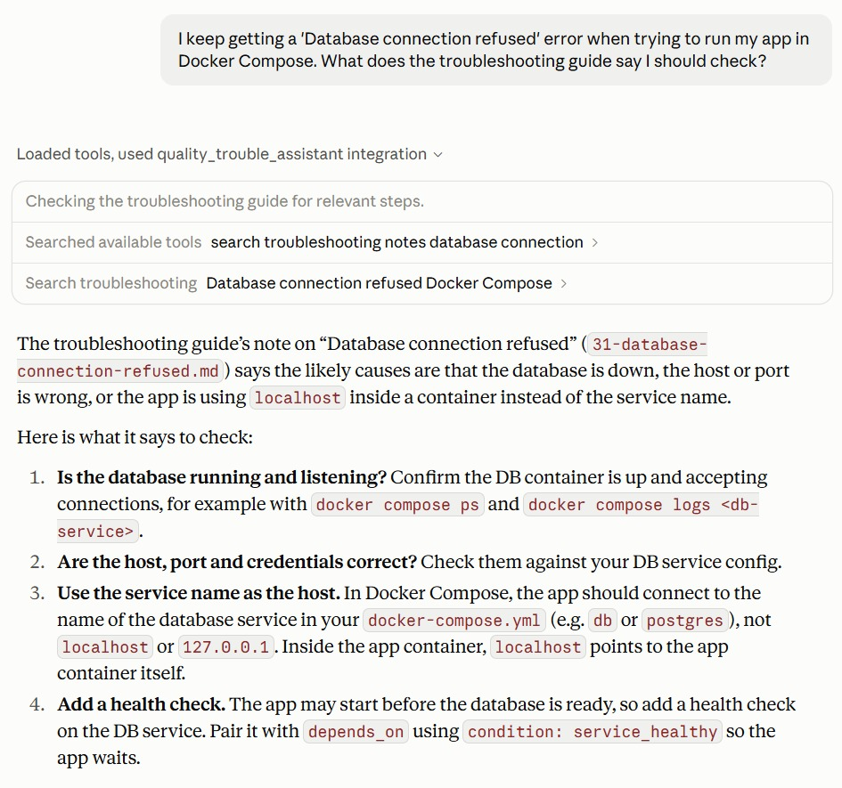
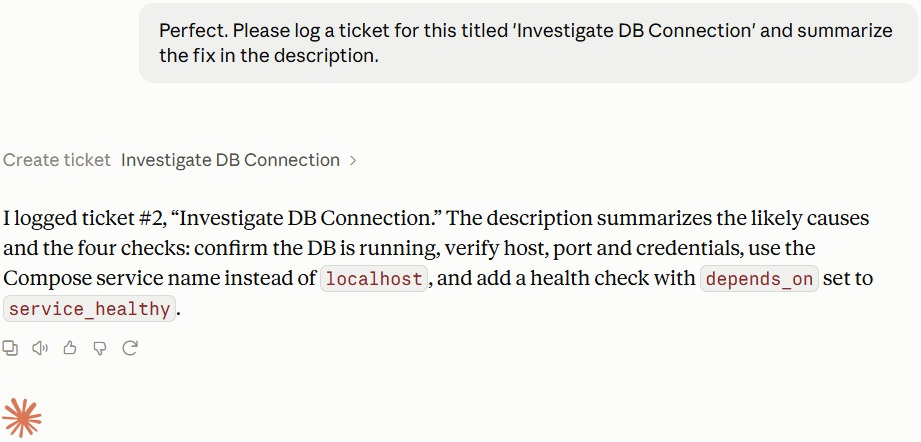
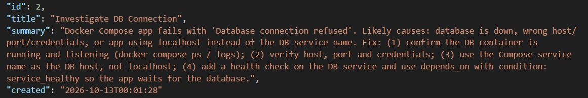

# Quality Troubleshooting Assistant (MCP + VectorDB)

An MCP server that lets an AI assistant (Claude Desktop) search a troubleshooting knowledge base by meaning, not just by keyword, and log a ticket when an issue needs follow-up.

Ask something like "My Docker container exits immediately, what should I check?" and the assistant calls the server, finds the matching fix from the knowledge base, and shows which file it came from. Then ask it to "log a ticket for this" and it writes the ticket to a JSON file.





## Features

- Semantic search over troubleshooting notes and public documentation (ChromaDB with sentence embeddings)
- Three MCP tools: search, list sources, create ticket
- Optional source filter to search only my own notes or only the public docs
- Every result includes the source file, so answers can be traced back
- Works with any MCP client (tested with MCP Inspector and Claude Desktop)

## How it works

```
docs/*.md  ->  ingest.py  ->  ChromaDB (embeddings)  ->  server.py (MCP tools)  ->  Claude Desktop
 (notes,       split by        local persistent          search / list /            asks questions,
  Docker,      heading,        vector store              create ticket              calls the tools
  Kubernetes)  add title
```

1. `scripts/ingest.py` reads every `.md` file under `docs/`, removes front matter and very long code blocks, and splits each file by heading (levels 1 to 3). Sections longer than 800 characters are split further with a 100-character overlap.
2. The note title is added to the top of every chunk, so a chunk such as "Fix" still carries the problem it belongs to.
3. Chunks are stored in a local ChromaDB collection with metadata: source file, title, chunk number and source type. ChromaDB's default embedding model (all-MiniLM-L6-v2) creates the embeddings.
4. `server.py` exposes the collection through an MCP server built with the official MCP Python SDK (FastMCP, stdio transport).

## MCP tools

| Tool | What it does |
|---|---|
| `search_troubleshooting(query, n_results=3, source_type="")` | Semantic search. Returns the matching text and its source file. `source_type` can be `notes` or `public`, or empty for all. |
| `list_sources()` | Lists the documents in the knowledge base. |
| `create_ticket(title, summary)` | Appends a ticket (id, title, summary, timestamp) to `tickets.json`. |

## Knowledge base

The knowledge base has 62 markdown files, split into 327 chunks.

| Folder | Files | Source type | Origin |
|---|---|---|---|
| `docs/notes/` | 36 | `notes` | Troubleshooting notes I wrote myself (symptoms, cause, fix) |
| `docs/docker/` | 18 | `public` | Troubleshooting and FAQ pages from the Docker documentation |
| `docs/kubernetes/` | 8 | `public` | Troubleshooting and debugging pages from the Kubernetes documentation |

## Data sources and licenses

- **Own notes** (`docs/notes/`): written by me.
- **Docker documentation** (`docs/docker/`): selected pages from [docker/docs](https://github.com/docker/docs). License: Apache-2.0 license
- **Kubernetes documentation** (`docs/kubernetes/`): selected pages from [kubernetes/website](https://github.com/kubernetes/website). License: CC-BY-4.0 license

The Docker and Kubernetes pages are copied unmodified and belong to their respective authors. Only a small subset of pages is included. No internal or proprietary company content is used anywhere in this project.

## Project structure

```
quality-trouble-assistant/
├── docs/
│   ├── notes/            # my own troubleshooting notes
│   ├── docker/           # selected Docker docs pages
│   └── kubernetes/       # selected Kubernetes docs pages
├── scripts/
│   └── ingest.py         # builds the ChromaDB collection
├── server.py             # MCP server
├── requirements.txt
└── README.md
```

`chroma_db/` (the generated vector store) and `tickets.json` (created at runtime) are git-ignored.

## Setup

Requires Python 3.10 or newer.

```bash
git clone https://github.com/pohling02/quality-trouble-assistant.git
cd quality-trouble-assistant

python3 -m venv venv
source venv/bin/activate
pip install -r requirements.txt
```

Build the vector store (run from the repo root). The first run downloads the embedding model:

```bash
python3 scripts/ingest.py
```

You should see a line like `Ingested 327 chunks from 62 files`. Re-run this script whenever you add or change documents.

## Test with MCP Inspector

```bash
npx @modelcontextprotocol/inspector /full/path/to/venv/bin/python /full/path/to/server.py
```

Open the URL it prints, connect, and call the tools under the Tools tab. For example, search for `container will not start`.

## Connect to Claude Desktop

Add the server to `claude_desktop_config.json`, using full paths.

macOS or Linux:

```json
{
  "mcpServers": {
    "quality-trouble-assistant": {
      "command": "/full/path/to/venv/bin/python",
      "args": ["/full/path/to/server.py"]
    }
  }
}
```

Windows with the project inside WSL:

```json
{
  "mcpServers": {
    "quality-trouble-assistant": {
      "command": "wsl.exe",
      "args": [
        "-e",
        "/home/<user>/quality-trouble-assistant/venv/bin/python",
        "/home/<user>/quality-trouble-assistant/server.py"
      ]
    }
  }
}
```

Fully quit and restart Claude Desktop, then try:

- "My Docker container exits immediately, what should I check?"
- "A pod is stuck in CrashLoopBackOff, how do I debug it?"
- "Log a ticket for this issue."

## Design notes

- **Chunk size and titles:** Small chunks give more precise matches, but a chunk like "Fix" is useless on its own. Splitting by heading and adding the note title to every chunk keeps each result self-contained.
- **Source tracking:** Every chunk keeps its file path, so the assistant can say where an answer came from.
- **Ticket datasets rejected:** I tested public support-ticket datasets (Kaggle and Hugging Face) and dropped them. The resolutions were random text, generic replies that only asked for more details, or missing entirely, which would have made search results worse. I used real documentation instead.
- **Stdio transport:** The server must never print to standard output, because that would corrupt the MCP protocol messages.

## Limitations

- Small knowledge base (62 files), mainly about Docker, Kubernetes and general development issues.
- Retrieval only returns relevant text. The AI client writes the final answer.
- Tickets are stored in a local JSON file, not a real ticketing system.
- No automatic check for outdated documentation.

## Future improvements

- Hybrid search (keyword plus vector) and result re-ranking
- Re-ingest only changed files
- Send tickets to a real system (for example Jira or GitHub Issues) instead of JSON
- Add an evaluation set of sample questions to measure search quality
- Larger knowledge base covering more topics

## Tech stack

Python, ChromaDB, MCP Python SDK (FastMCP), all-MiniLM-L6-v2 embeddings (ChromaDB default), Claude Desktop, MCP Inspector
